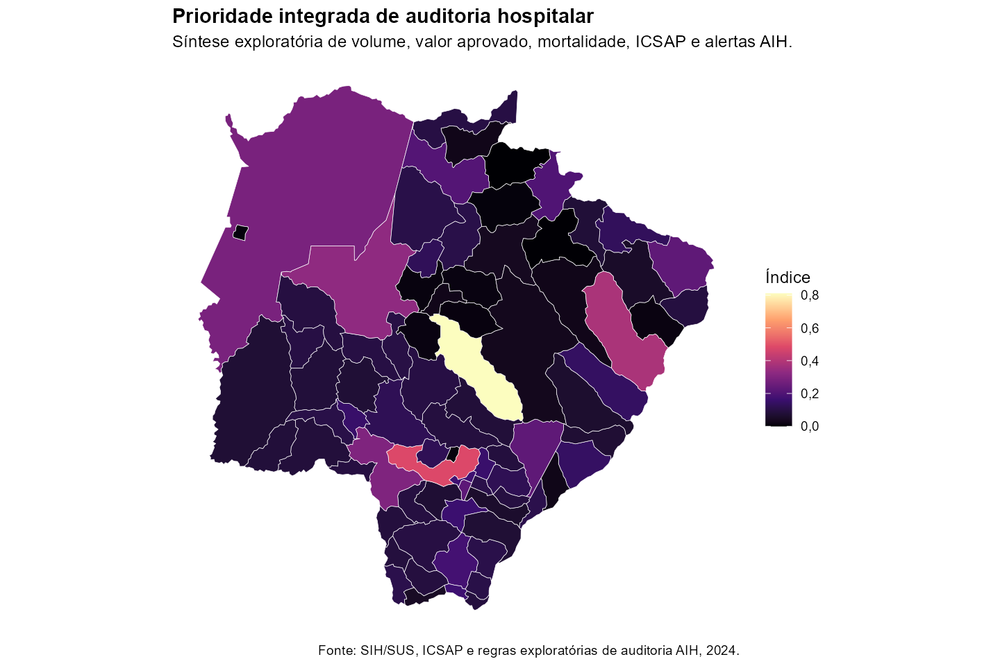
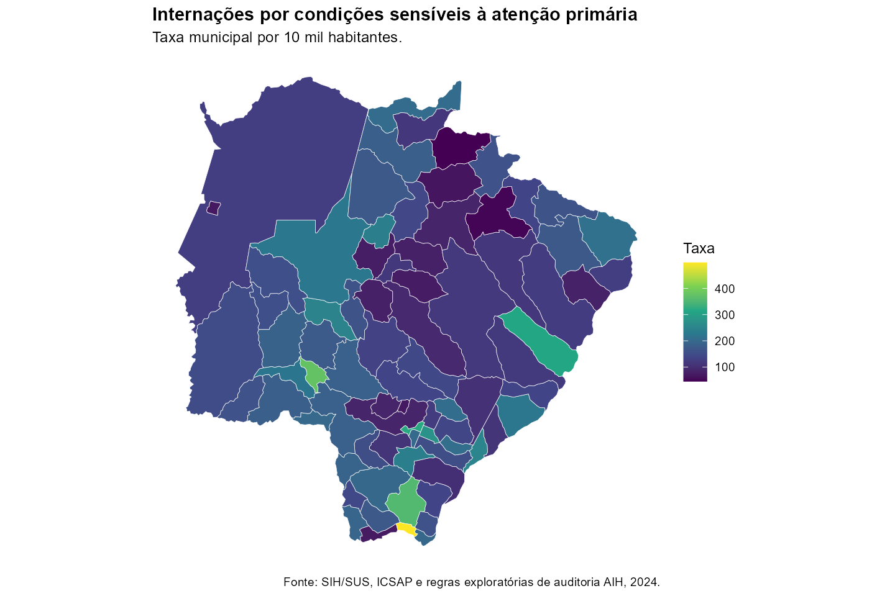
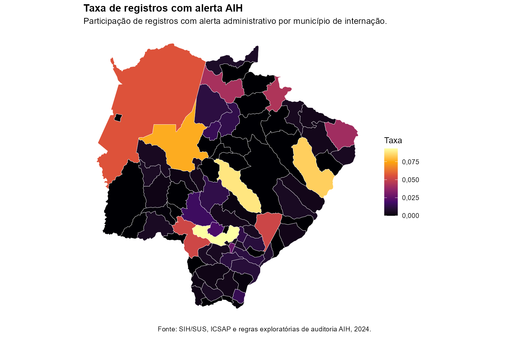
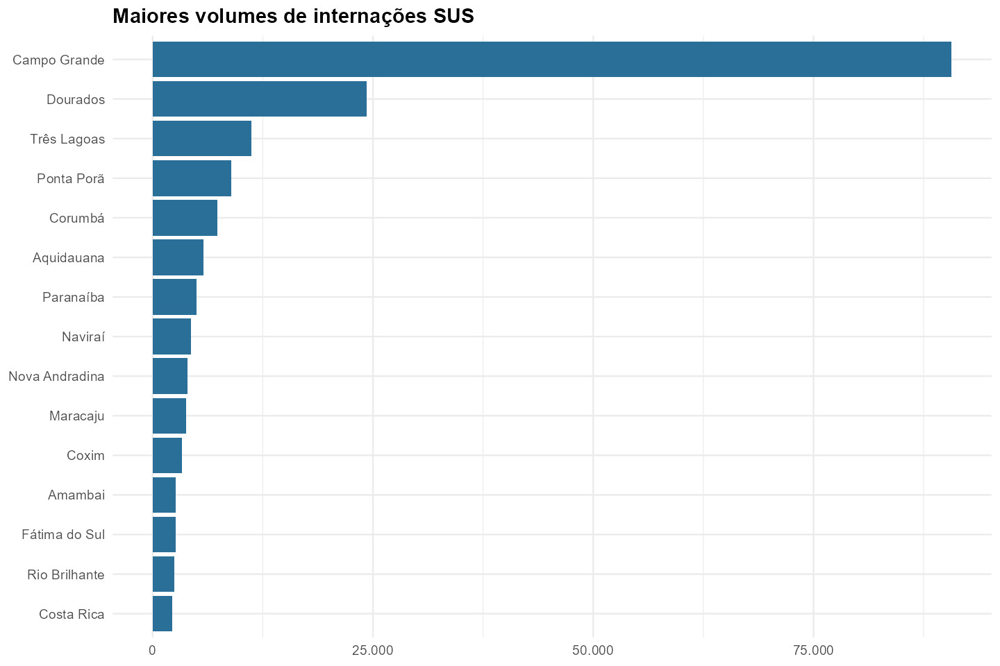
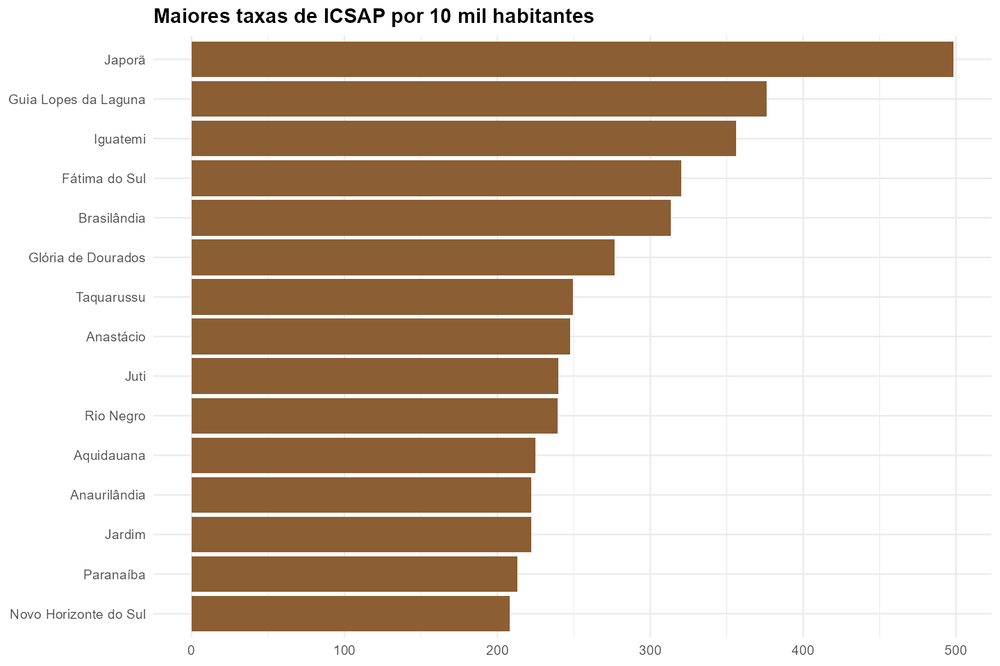
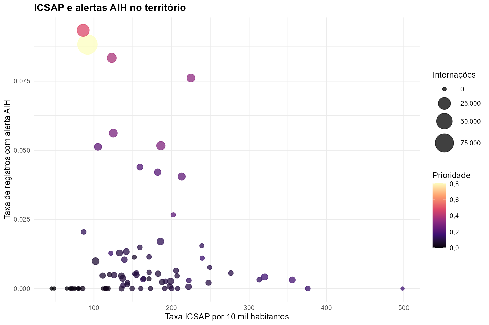

# Internações, ICSAP e Auditoria Hospitalar SUS | Mato Grosso do Sul

**Análise municipal da produção hospitalar, internações sensíveis à atenção primária e alertas exploratórios de AIH**


---

## Dashboard interativo

**[Abrir dashboard online](https://matheusassiso.github.io/saude-internacoes-icsap-auditoria-sus/)**

Painel com mapa dos 79 municípios de Mato Grosso do Sul e camadas alternáveis para prioridade integrada, taxa de ICSAP e alertas AIH.



---

## Objetivo

Integrar três análises hospitalares do SUS em um único projeto profissional:

1. produção de internações hospitalares;
2. internações por condições sensíveis à atenção primária (ICSAP);
3. alertas exploratórios de auditoria em AIH.

A pergunta central é:

> Como priorizar territórios e registros hospitalares para análise técnica quando volume, evitabilidade e alertas administrativos são observados em conjunto?

---

## Motivação

Internações, ICSAP e auditoria AIH costumam ser analisadas em painéis separados. Essa separação dificulta uma leitura operacional: municípios com grande produção podem ser polos regionais, municípios com alta ICSAP podem indicar pressão evitável sobre a rede, e municípios com muitos alertas AIH podem exigir revisão documental mais cuidadosa.

Este projeto consolida essas dimensões para apoiar:

- análise descritiva da produção hospitalar;
- análise exploratória de prioridades;
- análise geoespacial municipal;
- comunicação por relatório, mapas e dashboard.

---

## Dados

| Dimensão | Fonte analítica | Indicadores usados |
|---|---|---|
| Internações SUS | SIH/SUS RD 2024 | internações, valor aprovado, óbitos, permanência e mortalidade bruta |
| ICSAP | SIH/SUS com classificação ICSAP | internações sensíveis à APS, taxa por 10 mil habitantes, óbitos e valor aprovado |
| Auditoria AIH | regras exploratórias sobre AIH | registros com alerta, escore de alerta, prestadores e taxa de alerta |
| Mapas | malha municipal de MS | 79 municípios com indicadores consolidados |

---

## Método

```text
Bases processadas → padronização municipal → integração dos indicadores
→ índice exploratório → perfis municipais → mapas → dashboard e relatório
```

Etapas principais:

1. organização das bases finais em `data/source/`;
2. consolidação municipal em `data/processed/`;
3. cálculo de prioridade integrada;
4. classificação dos municípios em perfis exploratórios;
5. geração de mapas e rankings;
6. publicação do PDF, HTML e dashboard interativo.

---

## Resultados descritivos

| Indicador | Resultado |
|---|---:|
| Municípios no mapa | 79 |
| Municípios com internação registrada | 67 |
| Internações SUS | 214.811 |
| Valor aprovado | R$ 329.824.342 |
| Óbitos hospitalares | 8.900 |
| ICSAP | 37.750 |
| Valor aprovado em ICSAP | R$ 59.931.019 |
| Registros com alerta AIH | 13.478 |
| Escore total de alerta AIH | 29.963 |

---

## Mapas e evidências visuais

### Prioridade integrada


### Taxa de ICSAP por 10 mil habitantes



### Taxa de registros com alerta AIH



### Rankings exploratórios





### Cruzamento exploratório



---

## Entregáveis

- [Dashboard interativo online](https://matheusassiso.github.io/saude-internacoes-icsap-auditoria-sus/)
- [Arquivo HTML do dashboard](docs/internacoes_icsap_auditoria_dashboard.html)
- [Relatório PDF](internacoes_icsap_auditoria_sus.pdf)
- [Relatório RMarkdown](internacoes_icsap_auditoria_sus.Rmd)
- [Relatório HTML](docs/relatorio.html)
- [Base municipal consolidada](data/processed/municipios_internacoes_icsap_auditoria.csv)
- [GeoJSON municipal](data/processed/ms_internacoes_icsap_auditoria.geojson)

---

## Estrutura

```text
.
├── data/
│   ├── source/
│   └── processed/
├── docs/
│   ├── index.html
│   ├── internacoes_icsap_auditoria_dashboard.html
│   └── relatorio.html
├── figures/
├── scripts/
│   └── build_project.R
├── internacoes_icsap_auditoria_sus.Rmd
├── internacoes_icsap_auditoria_sus.pdf
├── saude-internacoes-icsap-auditoria-sus.Rproj
└── COMMIT_INSTRUCTIONS.txt
```

---

## Como reproduzir

Abra `saude-internacoes-icsap-auditoria-sus.Rproj` no RStudio e execute:

```r
source("scripts/build_project.R")
```

O script reconstrói dados consolidados, figuras, GeoJSON, dashboard, relatório HTML e PDF.

---

## Limitações

A análise é exploratória. Mortalidade bruta não ajusta risco, ICSAP não prova falha da atenção primária e alerta AIH não confirma irregularidade. Os resultados servem para priorizar investigação técnica, auditoria documental e validação institucional.

---

## Contato

**Matheus Assis de Oliveira**

[](https://github.com/matheusassiso)
