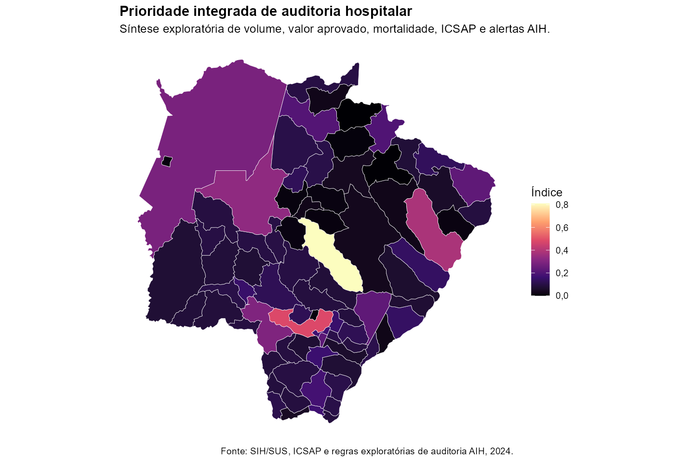
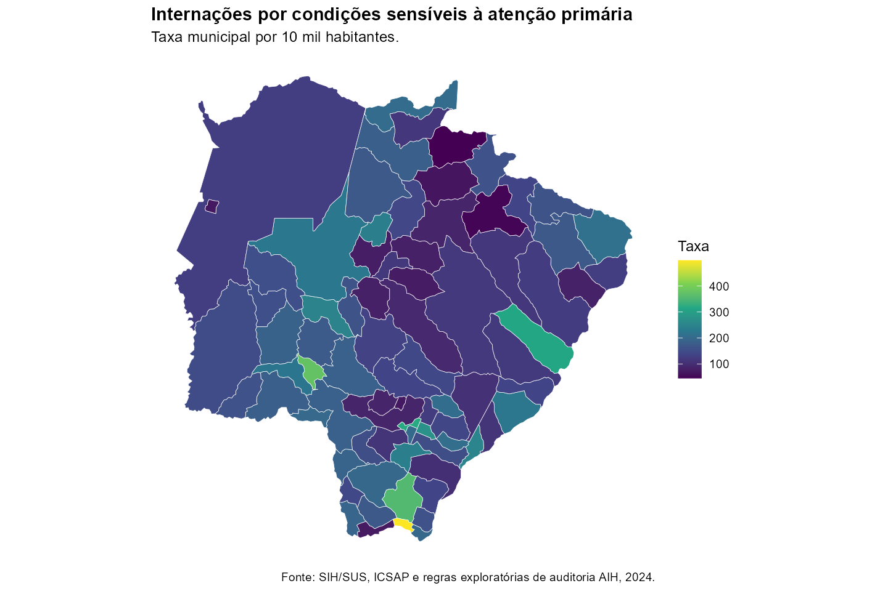
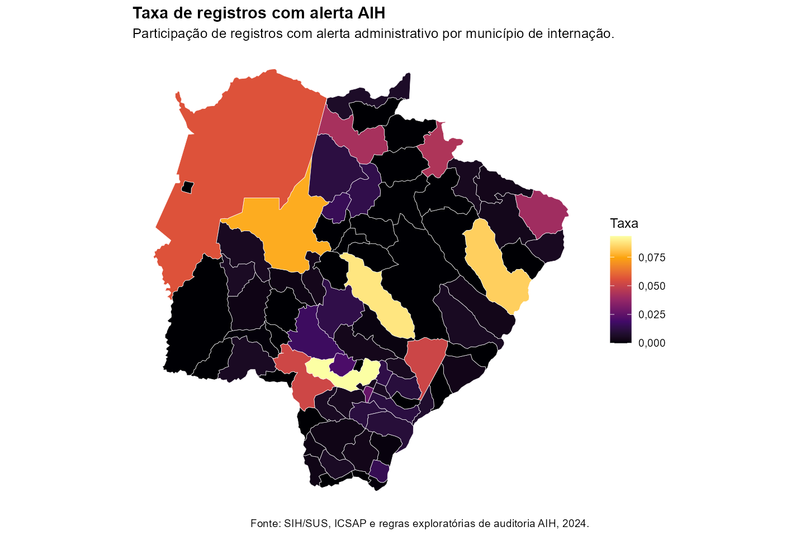
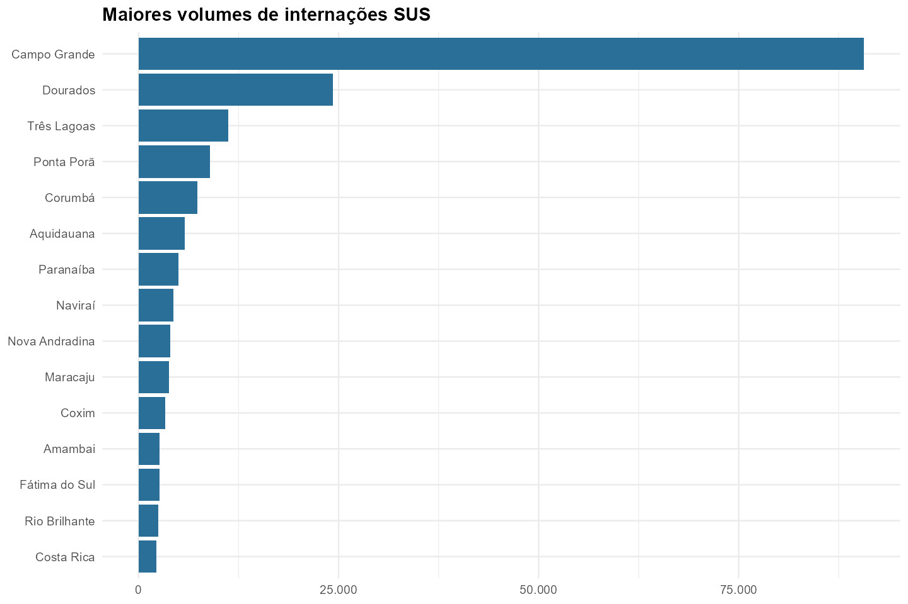
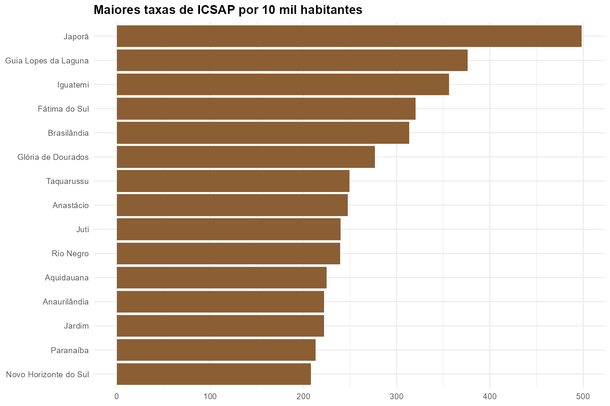
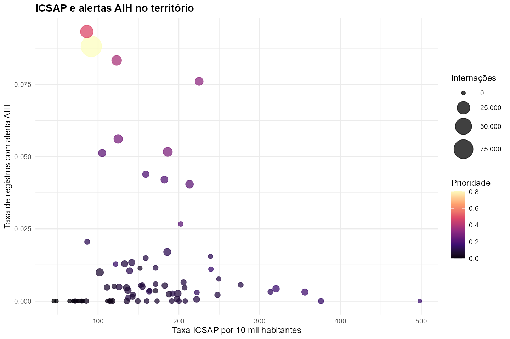

```{r setup, include=FALSE}
knitr::opts_chunk$set(echo = FALSE, warning = FALSE, message = FALSE)
library(dplyr)
library(ggplot2)
library(knitr)
library(readr)
library(scales)

base <- read_csv("data/processed/municipios_internacoes_icsap_auditoria.csv", show_col_types = FALSE)
resumo <- read_csv("data/processed/resumo_indicadores.csv", show_col_types = FALSE)
perfis <- read_csv("data/processed/perfis_municipais.csv", show_col_types = FALSE)
br_num <- label_number(big.mark = ".", decimal.mark = ",")
br_money <- label_dollar(prefix = "R$ ", big.mark = ".", decimal.mark = ",")
```

# Introdução

Este projeto organiza três frentes complementares de análise hospitalar do SUS em Mato Grosso do Sul: produção de internações, internações por condições sensíveis à atenção primária (ICSAP) e alertas exploratórios de auditoria em AIH.

A proposta não é substituir auditoria documental, ajuste de risco ou avaliação clínica. O objetivo é construir uma leitura profissional para triagem: quais municípios concentram produção, onde a pressão por condições evitáveis é maior e onde os registros hospitalares apresentam sinais administrativos que merecem revisão.

# Motivação

Os dados do SIH/SUS permitem observar volume, valor aprovado, mortalidade bruta e permanência média. A leitura de ICSAP acrescenta uma dimensão de evitabilidade associada à atenção primária. A auditoria analítica de AIH adiciona alertas administrativos, como concentração de custo, permanência prolongada e perfis de procedimento que exigem inspeção.

Quando essas bases são lidas separadamente, o resultado vira uma coleção de painéis. Quando são integradas por município, elas passam a sustentar uma fila de análise: primeiro o território, depois o perfil assistencial, depois a revisão documental.

# Dados e método

Foram consolidadas bases processadas de 2024 com abrangência municipal. A malha geográfica contém os 79 municípios de Mato Grosso do Sul. A produção hospitalar é lida por município de internação; a ICSAP é lida por município de residência.

O pipeline foi:

1. padronização de códigos municipais;
2. consolidação de indicadores de internação, ICSAP e alertas AIH;
3. preenchimento de municípios sem produção hospitalar registrada como zero para fins cartográficos;
4. cálculo de índice exploratório de prioridade integrada;
5. classificação de perfis municipais;
6. geração de mapas, rankings, relatório e dashboard interativo.

# Resultados descritivos

```{r resumo}
resumo |>
  mutate(valor = case_when(
    indicador %in% c("Valor aprovado", "Valor aprovado em ICSAP") ~ br_money(valor),
    TRUE ~ br_num(valor)
  )) |>
  kable(col.names = c("Indicador", "Resultado"))
```

Em 2024, a base consolidada registra `r br_num(sum(base$internacoes))` internações SUS e `r br_money(sum(base$valor_aprovado))` em valor aprovado. O recorte de ICSAP soma `r br_num(sum(base$internacoes_icsap))` internações, enquanto a auditoria analítica identifica `r br_num(sum(base$registros_alerta))` registros com alerta AIH.

# Perfis municipais

```{r perfis}
perfis |>
  arrange(desc(municipios)) |>
  kable(col.names = c("Perfil", "Municípios"))
```

Os perfis são exploratórios. Um município classificado como polo hospitalar pode concentrar produção regional sem representar maior risco populacional. Um município com taxa elevada de ICSAP pode apontar demanda evitável, barreira de acesso ou composição populacional específica. Alertas AIH são sinais para auditoria, não prova de irregularidade.

# Análise geoespacial

## Prioridade integrada

```{r mapa-prioridade, out.width="100%"}

```

O mapa sintetiza volume, valor aprovado, mortalidade bruta, taxa de ICSAP e alertas AIH. Ele funciona como triagem territorial para orientar onde aprofundar a análise.

## Taxa de ICSAP

```{r mapa-icsap, out.width="100%"}

```

A taxa de ICSAP por 10 mil habitantes destaca municípios em que internações potencialmente evitáveis têm maior peso relativo. A leitura deve considerar porte populacional, oferta local e fluxo regional de pacientes.

## Alertas AIH

```{r mapa-alertas, out.width="100%"}

```

A taxa de alerta AIH mostra a proporção de registros com características administrativas que justificam inspeção técnica. Ela apoia priorização, mas não substitui avaliação documental.

# Análise exploratória

```{r ranking-internacoes, out.width="100%"}

```

```{r ranking-icsap, out.width="100%"}

```

```{r dispersao, out.width="100%"}

```

O cruzamento entre taxa de ICSAP e taxa de alerta AIH separa municípios com pressão assistencial evitável, polos com grande volume hospitalar e territórios onde a auditoria deve começar pela documentação dos registros.

# Dashboard

O dashboard interativo está em `docs/internacoes_icsap_auditoria_dashboard.html`. Ele contém camadas alternáveis para prioridade integrada, taxa de ICSAP e taxa de alertas AIH, com popups municipais.

# Limitações

A análise é descritiva e exploratória. Os indicadores não ajustam idade, gravidade, diagnóstico, complexidade hospitalar ou fluxo de referência. A produção hospitalar por município de internação não equivale ao risco de adoecimento dos residentes. Alertas AIH indicam necessidade de revisão, não irregularidade confirmada.

# Conclusão

A integração de internações, ICSAP e auditoria AIH transforma bases públicas isoladas em uma leitura municipal acionável. Para um portfólio profissional de análise de dados, o valor do projeto está na organização da pergunta, na documentação do método, na reprodutibilidade e na entrega visual dos resultados por mapas, relatório e dashboard.
